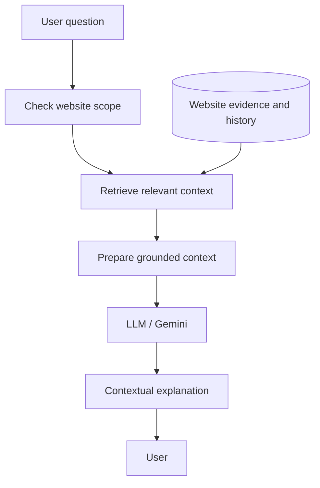

# Contextual AI and retrieval

COPLIT's AI layer is intended to explain collected website evidence, not invent technical findings or decide independently that a correction succeeded.

## Concepts and responsibilities

| Concept | Meaning and COPLIT application |
|---|---|
| LLM | Large language model; interprets natural-language questions and generates contextual explanations |
| Gemini | Intended model provider; accessed through Google GenAI integration |
| RAG | Retrieval-augmented generation; retrieves relevant records before generation rather than relying on model memory |
| Embeddings | Numerical representations that can support semantic similarity search |
| Vector knowledge store | Historical source review identifies a vector knowledge store component; current indexing and retrieval behavior require validation |
| Structured retrieval | SQL lookups for authorized audit, finding and evidence records |
| Context preparation | Select relevant evidence and conversation history within the connected website scope |
| Conversation orchestration | Coordinate understanding, evidence, guidance and continuity |
| Model adapter | Separate provider-specific calls from product logic; model-agnostic design direction |

Logical design, not a claim of completed integrated RAG or live provider acceptance.

## Example

If a user asks why a page has a missing H1, retrieve the corresponding finding and page observation. Explain the heading issue in plain language and suggest a relevant correction. If the evidence is missing, acknowledge that limitation rather than inventing a page observation. After a correction, a deterministic check evaluates the page condition independently of the LLM.

## Design trade-offs

Structured retrieval is appropriate for exact identifiers and relational evidence. Semantic retrieval can help with natural-language relevance but needs ownership filters and relevance evaluation. A separate vector database is not assumed. Gemini can be replaced in principle through an adapter, but provider portability requires testing.

## Acceptance criteria

- Responses stay within the authorized connected website.
- Claims are traceable to retrieved observations.
- Missing evidence and provider failures are explicit.
- Conversation history does not override newer authoritative evidence.
- AI explanations never substitute for deterministic verification.

Historical conversational understanding checks reported 17/17 passing. This is component-level evidence, not an accuracy benchmark or proof of end-to-end RAG behavior.

[Architecture](ARCHITECTURE.md) · [Validation](VALIDATION-AND-LIMITATIONS.md)
