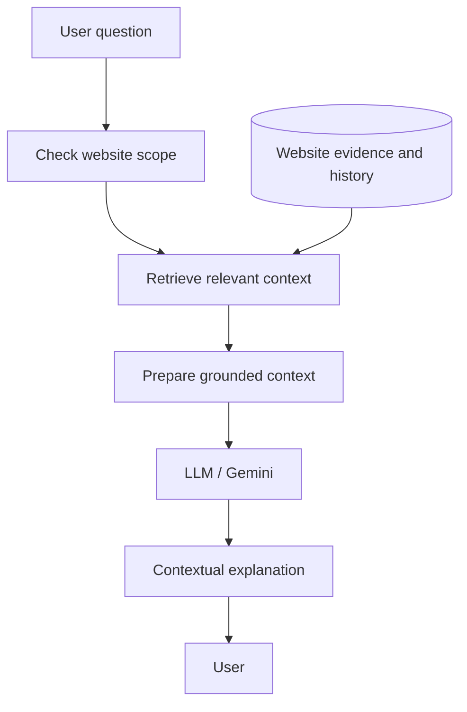

# How COPLIT uses AI

The AI design assigns language models a specific responsibility: interpret questions and explain collected website evidence. Technical findings and verification outcomes remain the responsibility of inspection and rule-based checks.

## Why retrieval is necessary

An LLM can explain general SEO concepts without knowing the current state of a particular website. Retrieval-augmented generation (RAG) is the design for supplying relevant stored observations before generating an answer. For exact page or finding identifiers, relational lookup is preferable to similarity alone. Semantic retrieval can help when a question is phrased differently from the stored information. Neither retrieval nor generation proves that a website has changed; that requires reinspection.

## The technologies behind the answers

| Concept | Meaning and COPLIT application |
|---|---|
| LLM | Large language model; interprets natural-language questions and generates contextual explanations |
| Gemini | Intended model provider; accessed through Google GenAI integration |
| RAG | Retrieval-augmented generation; retrieves relevant records before generation rather than relying on model memory |
| Embeddings | Numerical representations that can support semantic similarity search |
| Vector knowledge store | Historical source review identifies a vector knowledge store component; current indexing and retrieval behavior require validation |
| Structured retrieval | SQL lookups for authorized audit, finding and evidence records |
| Context preparation | Select relevant evidence and conversation history within the connected website scope |
| Conversation orchestration | Coordinate understanding, evidence, guidance and continuity |
| Model adapter | Separate provider-specific calls from product logic; model-agnostic design direction |

This diagram defines the AI information flow. The [validation scope](VALIDATION-AND-LIMITATIONS.md) distinguishes recorded question-interpretation checks from integrated retrieval and Gemini acceptance, which are not established by those checks.

## Example: explaining a missing heading

If a user asks why a page has a missing H1, retrieve the corresponding finding and page observation. Explain the heading issue in plain language and suggest a relevant correction. If the evidence is missing, acknowledge that limitation rather than inventing a page observation. After a correction, a deterministic check evaluates the page condition independently of the LLM.

## Example of the information boundary

The following is an illustrative contract, not a captured model request or response.

| Input to explanation | Source |
|---|---|
| Website and audit identity | Authorized workspace |
| Affected page and finding | Stored observation |
| Relevant previous interaction | Conversation history, if applicable |
| Suggested correction | Explanation generated from available context |
| Verification result | Independent reinspection, not the language model |

## Retrieval strategy

Structured retrieval is appropriate for exact identifiers and relational evidence. Semantic retrieval can help with natural-language relevance but needs ownership filters and relevance evaluation. A separate vector database is not assumed. Gemini can be replaced in principle through an adapter, but provider portability requires testing.

## Design decisions and failure handling

| Situation | Design response | Reason |
|---|---|---|
| Exact finding or page requested | Prefer structured retrieval | Exact identifiers require precise matching |
| Natural-language question | Consider semantic relevance within authorized context | Similarity alone does not establish correctness |
| Evidence unavailable | Communicate uncertainty | Avoid inventing website observations |
| Older conversation conflicts with new inspection | Prefer current authoritative evidence | Website state can change |
| User reports a correction | Invoke an independent supported check | A model's agreement is not verification |

The design prioritizes answer reliability over unrestricted conversational output. These are behavioral requirements; their integrated acceptance is tracked separately.

## AI acceptance criteria

- Responses stay within the authorized connected website.
- Claims are traceable to retrieved observations.
- Missing evidence and provider failures are explicit.
- Conversation history does not override newer authoritative evidence.
- AI explanations never substitute for deterministic verification.

The recorded conversational understanding component checks evaluated interpretation of user questions and all passed. The checks concern question interpretation, rather than model accuracy. [See the validation scope](VALIDATION-AND-LIMITATIONS.md).

[Architecture](ARCHITECTURE.md) · [Validation](VALIDATION-AND-LIMITATIONS.md)

---
[Portfolio home](README.md) · [Product](PRODUCT-CASE-STUDY.md) · [Architecture](ARCHITECTURE.md) · [AI](AI-INTELLIGENCE.md) · [Engineering](ENGINEERING-CASE-STUDIES.md) · [Validation](VALIDATION-AND-LIMITATIONS.md) · [LinkedIn](https://www.linkedin.com/in/aravindmugappagari)
