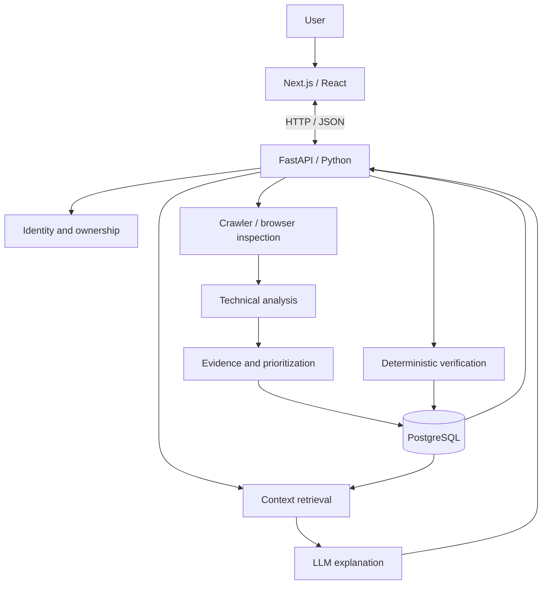
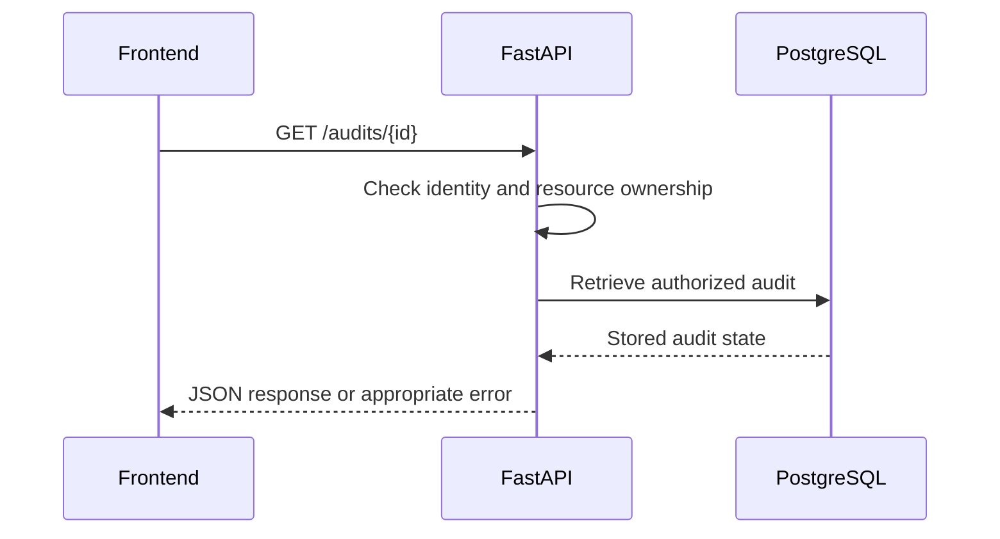
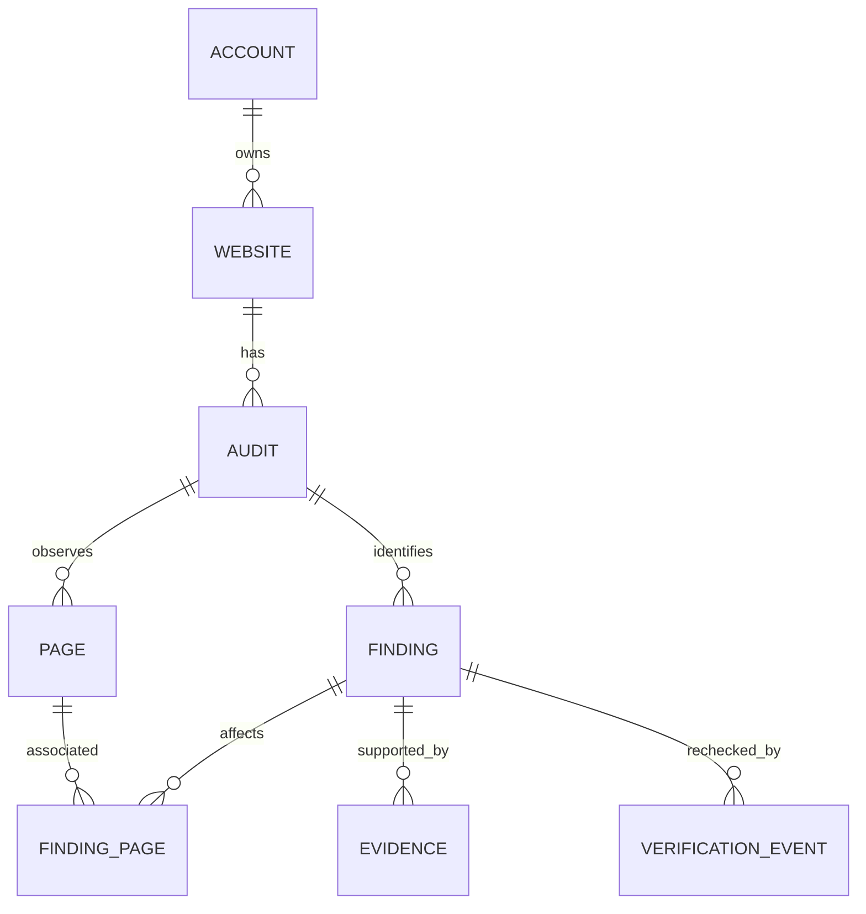

# System architecture

COPLIT separates presentation, orchestration, website observation, analysis, explanation and verification. The following is a logical architecture, not a production deployment diagram.

## Technology responsibilities

| Technology | What it is and why it fits COPLIT |
|---|---|
| Next.js | React application framework; organizes routes and the guided workspace |
| React | Component-based UI library; renders audit, evidence and interaction state |
| TypeScript | Typed JavaScript; helps catch mismatched UI and API data contracts |
| Tailwind CSS | Utility-based styling; supports consistent, minimal presentation |
| HTML / CSS | Browser document structure and visual layout |
| Node.js | JavaScript runtime for frontend development and build tooling |
| Python | Backend language suited to crawling, data processing and AI integration |
| FastAPI | Python API framework; exposes application operations and typed request boundaries |
| Uvicorn / ASGI | Server and application interface supporting asynchronous Python web requests |
| Pydantic / Pydantic Settings | Data validation and configuration management |
| REST / HTTP / JSON | Resource-oriented operations, transport semantics and structured payloads |
| HTTPX / HTTPCore | HTTP client and lower-level transport dependencies identified in historical source review |
| PostgreSQL / SQL | Relational persistence and querying of connected website records |
| Psycopg | Python driver for PostgreSQL connections and transactions |
| Custom crawler | Discovers URLs and collects observations under crawl limits |
| Beautiful Soup | Parses HTML into inspectable document structures |
| Playwright | Browser automation for rendered-page inspection where supported |
| Google GenAI SDK / Gemini | Model integration for contextual explanation; integrated runtime remains pending |
| Transformers / PyTorch / NumPy | Dependencies identified in historical review for model and numerical processing; exact current runtime use needs reconciliation |
| Python-dotenv | Loads environment-based configuration in development; not a secret vault |
| SSE | Server-sent events for progressive responses; live lifecycle acceptance pending |

## Communication in practice

The endpoint is documented in the frontend records. The ownership check represents the intended security contract, not a completed cross-account acceptance test.

## Data model

Conceptual relationships, not an exact schema export. Links, intelligence snapshots and conversation records also support inspection and continuity. Transactions should preserve consistent finding and verification state.

## Website inspection and intelligence

The crawler discovers pages and links, normalizes URLs, fetches content and parses technical signals. Browser rendering complements HTTP inspection when JavaScript changes the visible document. Analysis components (historically F-series and L-series) turn observations into findings, evidence and prioritized work. Conversational components (T-series) support contextual interaction.

## Why these choices?

| Choice | Alternative | Rationale |
|---|---|---|
| Next.js / React | Vue or Angular | Component-oriented interactive workspace |
| FastAPI | Flask, Django or Express | Fits Python crawling and intelligence services |
| PostgreSQL | Document database | Relational ownership, findings and history |
| HTTP plus browser inspection | HTTP only | Browser observation can reveal rendered content; costs more resources |
| Deterministic verification | Model-only judgment | Recheck observable conditions independently of generated text |

## Security and operations

Account authentication, session handling and resource ownership define the intended multi-user boundary. Historical source reviews identify URL validation, secure redirects, network checks and browser interception as SSRF defenses. Comprehensive security acceptance remains necessary.

Local development uses Windows, PowerShell, a Python virtual environment and Node tooling. CORS, environment configuration, dependency reproducibility, migrations, health checks, timeouts and recovery are operational concerns. Production hosting, orchestration and scalability are not claimed.

[AI and retrieval](AI-INTELLIGENCE.md) · [Engineering investigations](ENGINEERING-CASE-STUDIES.md) · [Validation](VALIDATION-AND-LIMITATIONS.md)
