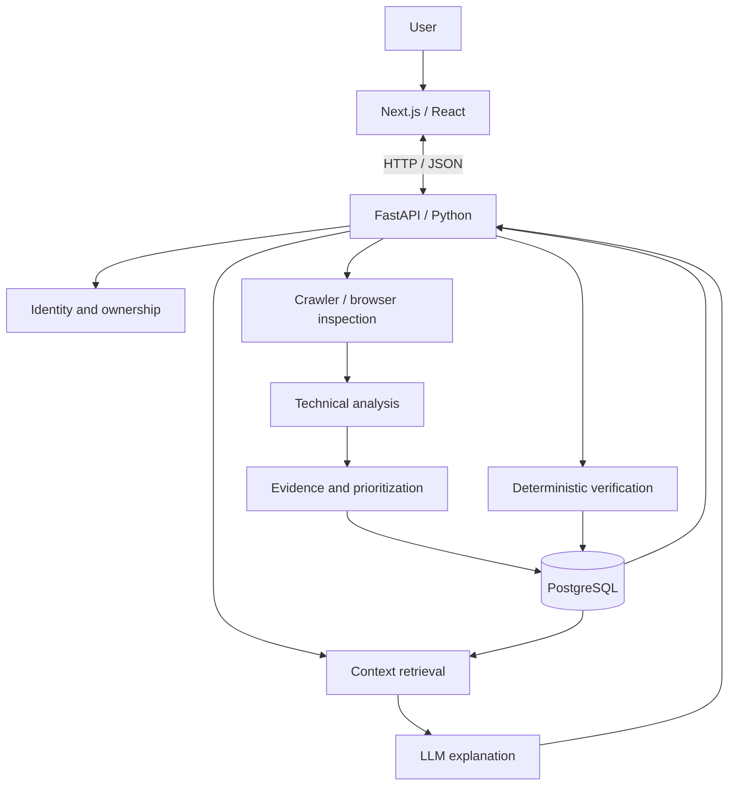
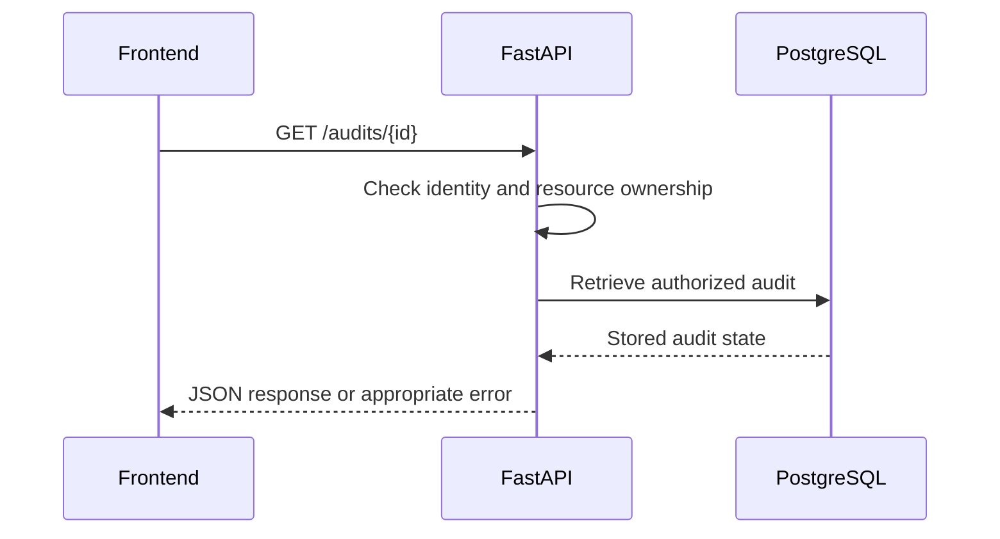
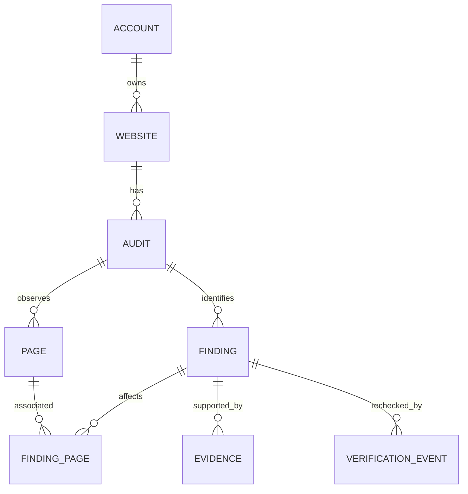

# System architecture

When someone connects a website, several parts of COPLIT work together. The interface collects the request, the backend runs the checks, the database saves the results, and the AI helps explain them. This diagram shows how the parts are designed to connect, not a live deployment.

## What each technology does

| Technology | What it is and why it fits COPLIT |
|---|---|
| Next.js | React application framework; organizes routes and the guided workspace |
| React | Component-based UI library; renders audit, evidence and interaction state |
| TypeScript | Typed JavaScript; helps catch mismatched UI and API data contracts |
| Tailwind CSS | Utility-based styling; supports consistent, minimal presentation |
| HTML / CSS | Browser document structure and visual layout |
| Node.js | JavaScript runtime for frontend development and build tooling |
| Python | Backend language suited to crawling, data processing and AI integration |
| FastAPI | Python API framework; exposes application operations and typed request boundaries |
| Uvicorn / ASGI | Server and application interface supporting asynchronous Python web requests |
| Pydantic / Pydantic Settings | Data validation and configuration management |
| REST / HTTP / JSON | Resource-oriented operations, transport semantics and structured payloads |
| HTTPX / HTTPCore | HTTP client and lower-level transport dependencies identified in historical source review |
| PostgreSQL / SQL | Relational persistence and querying of connected website records |
| Psycopg | Python driver for PostgreSQL connections and transactions |
| Custom crawler | Discovers URLs and collects observations under crawl limits |
| Beautiful Soup | Parses HTML into inspectable document structures |
| Playwright | Browser automation for rendered-page inspection where supported |
| Google GenAI SDK / Gemini | Model integration for contextual explanation; integrated runtime remains pending |
| Transformers / PyTorch / NumPy | Dependencies identified in historical review for model and numerical processing; exact current runtime use needs reconciliation |
| Python-dotenv | Loads environment-based configuration in development; not a secret vault |
| SSE | Server-sent events for progressive responses; live lifecycle acceptance pending |

## How the frontend asks for saved results

The endpoint is documented in the frontend records. The ownership check represents the intended security contract, not a completed cross-account acceptance test.

## How website information is stored

Conceptual relationships, not an exact schema export. Links, intelligence snapshots and conversation records also support inspection and continuity. Transactions should preserve consistent finding and verification state.

## From a website URL to a report

1. The frontend collects the URL and sends a request to the backend.
2. The design requires the backend to check identity and URL safety before starting website inspection.
3. The crawler discovers links, fetches pages and collects HTML and response information. Beautiful Soup helps inspect HTML; Playwright can inspect content after JavaScript runs.
4. SEO checks examine the observations and create findings linked to affected pages.
5. The application organizes findings and saves evidence in PostgreSQL.
6. The frontend requests progress and displays results. AI can help explain the saved evidence, and supported checks can run again after a fix.

The documented frontend uses GET /audit-progress/{progressId} for polling and POST /audits/{id}/initial-task-response for an initial task explanation. These are recorded source interfaces, not newly tested requests.

## Troubleshooting system boundaries

| Observation | Boundary to investigate |
|---|---|
| Browser request fails | Frontend network request, API route and HTTP response |
| Audit stops progressing | Progress endpoint, backend job state and stored audit records |
| Request exceeds its time budget | Service deadline, database connection and transaction limits |
| Explanation lacks website evidence | Authorized retrieval scope and context preparation |

This is a diagnostic guide, not a record of additional incidents. See the [engineering investigations](ENGINEERING-CASE-STUDIES.md) for recorded work.

## How the smaller parts fit together

| Concept | Why it matters |
|---|---|
| HTML and DOM | HTML is the page markup; the DOM is the browser's representation of the document, which can change after scripts run. |
| URL normalization | Avoid treating equivalent URL forms as unrelated pages, without merging genuinely different resources. |
| Redirects | Follow a changed address only after checking that the destination is safe. |
| Crawl limits | Bound page count, time and resource use; a crawl is not necessarily the entire website. |
| Primary and foreign keys | Identify records and connect an audit to its pages, findings and evidence. |
| Transactions | Save related changes together or roll them back if an operation fails. |
| Sessions and authorization | Identify the signed-in user and check that they own the requested website or audit. |
| SSRF | Prevent user-supplied URLs from making the server access private or internal network resources. |
| CORS | Controls which browser origins may access the API; it does not replace authentication. |
| Migrations | Track database schema changes so existing records can be preserved. |
| Health checks | Help distinguish a running server from one whose required dependencies are ready. |
| Timeouts | Limit waiting for HTTP requests, database connections and transactions. |
| Polling and SSE | Polling repeatedly asks for progress; SSE lets a server send events over an open HTTP connection. |
| Environment configuration | Keep deployment-specific settings outside source code; protect secrets separately. |
| Virtual environment | Keep Python project dependencies together without changing the system-wide installation. |

These explain the design and historical source findings. Full current dependency usage and security behavior still need verification.

## Website inspection and intelligence

The crawler discovers pages and links, normalizes URLs, fetches content and parses technical signals. Browser rendering complements HTTP inspection when JavaScript changes the visible document. Analysis components turn observations into findings, evidence and prioritized work. Conversational components support contextual interaction.

## Architectural judgment

| Design decision | Alternative | Benefit | Cost or constraint |
|---|---|---|---|
| Next.js / React and FastAPI | Vue, Angular, Flask, Django or Express | Clear interface between interaction and inspection logic | Requires compatible API contracts and coordinated error handling |
| PostgreSQL relational storage | Document database | Trace findings to pages, audits and verification events | Requires schema management and transaction discipline |
| Combine HTTP and browser inspection | HTTP only | Observe both response markup and rendered content | Browser execution consumes additional time and resources |
| Separate explanation from verification | Model-only judgment | Prevent generated text from becoming proof of a correction | Requires dedicated checks for supported issue types |
| Bound request and database waiting | API-only timeout | Avoid indefinite waiting and communicate failures | Time budgets must propagate across service boundaries |

My architectural work centers on defining these responsibilities and tracing how requests, data and errors cross them. The trade-offs explain the design rationale; they do not imply that every alternative was benchmarked.

## Protecting accounts and keeping the application running

Account authentication, session handling and resource ownership define the intended multi-user boundary. Historical source reviews identify URL validation, secure redirects, network checks and browser interception as SSRF defenses. Comprehensive security acceptance remains necessary.

Local development uses Windows, PowerShell, a Python virtual environment and Node tooling. CORS, environment configuration, dependency reproducibility, migrations, health checks, timeouts and recovery are operational concerns. Production hosting, orchestration and scalability are not claimed.

[AI and retrieval](AI-INTELLIGENCE.md) · [Engineering investigations](ENGINEERING-CASE-STUDIES.md) · [Validation](VALIDATION-AND-LIMITATIONS.md)

---
[Portfolio home](README.md) · [Product](PRODUCT-CASE-STUDY.md) · [Architecture](ARCHITECTURE.md) · [AI](AI-INTELLIGENCE.md) · [Engineering](ENGINEERING-CASE-STUDIES.md) · [Validation](VALIDATION-AND-LIMITATIONS.md) · [LinkedIn](https://www.linkedin.com/in/aravindmugappagari)
