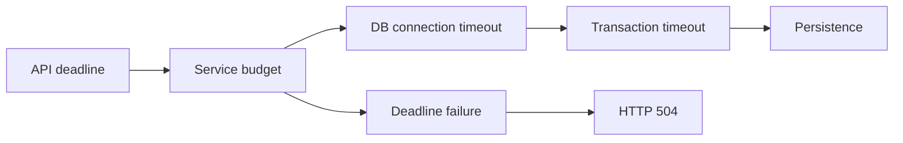
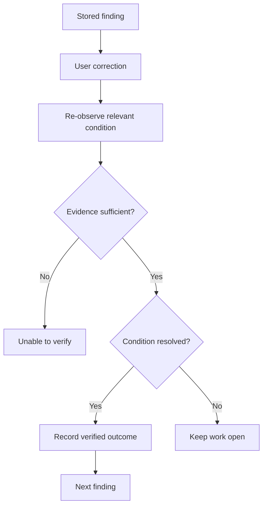

# Engineering investigations

These investigations describe recorded development work, not production incidents.

## 1. Request reliability

**Problem:** An API deadline can be ineffective when downstream services or database operations ignore the remaining time budget.

I traced the request path and coordinated changes to deadline propagation, connection and transaction limits, persistence forwarding and API error mapping. The combined P11 patch set passed 6/6 syntax, 31/31 mocked behavior and 9/9 source-contract checks. Live deadline mapping remains pending.

## 2. Streaming lifecycle

SSE allows a server to send incremental events over an HTTP connection. Completion, exceptions and client disconnects require consistent cleanup. Streaming lifecycle repairs were included in the P11 offline acceptance set; live disconnect and recovery behavior remain unverified.

## 3. Deterministic verification

Historical local audit #58 recorded two supported findings verified fixed and next-finding progression. The example demonstrates a local workflow, not universal verification coverage. Missing H1 and missing meta description are documented supported examples.

## 4. Grounded conversational intelligence

Generic answers may be plausible but unsupported. The design separates authoritative findings from model-generated explanation, retrieves website-specific context and avoids rigid keyword-driven replies. Conversational understanding recorded 17/17 local checks; integrated grounding and model behavior remain acceptance tasks.

## 5. Troubleshooting approach

The following is a diagnostic playbook, not a record of additional incidents.

| Symptom | Investigate | Expected handling |
|---|---|---|
| 401 / 403 | Session validity and resource ownership | Require authentication or deny unauthorized access |
| 404 | Resource identity or missing route | Explain missing resource without leaking other accounts |
| 504 | Remaining deadline, service and database timing | Return a clear timeout rather than hang |
| Audit progress stalls | Polling, job state and backend availability | Preserve uncertainty and avoid false completion |
| Verification fetch fails | Network response and evidence sufficiency | Report inability to verify, not a successful fix |
| AI response lacks evidence | Retrieval scope and context | Acknowledge missing evidence |

My approach is to reproduce the symptom where safe, trace the affected boundary, identify the cause, review a targeted correction and validate the result. AI-assisted implementation is part of this workflow; the evidence determines whether a change is accepted.

[Architecture](ARCHITECTURE.md) · [Validation](VALIDATION-AND-LIMITATIONS.md)
