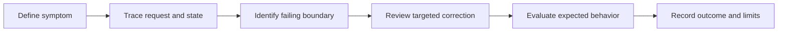
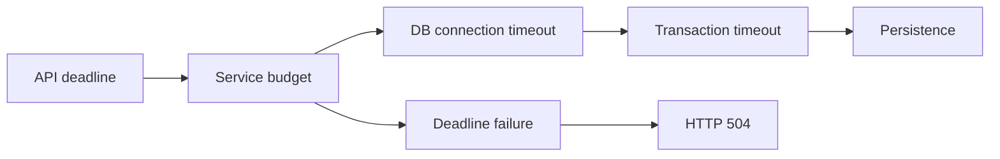
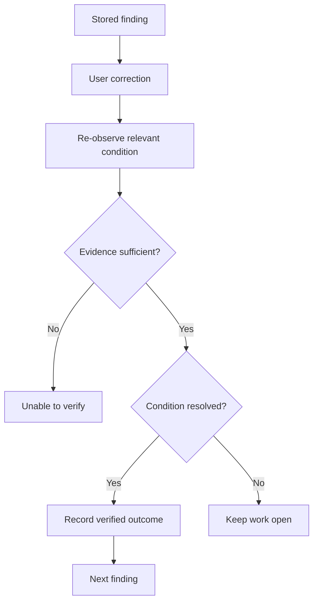

# Technical problems I worked on

These investigations describe recorded development work, not production incidents.

## Investigation approach

I use AI assistance for code exploration and development, while focusing my review on requirements, system boundaries, proposed corrections and acceptance results. The investigation records below distinguish observed outcomes from diagnostic guidance.

## 1. Request reliability

**Problem:** Setting a time limit on an API request is not enough if the database or another service keeps waiting after that limit.

I traced the request path and coordinated changes to deadline propagation, connection and transaction limits, persistence forwarding and API error mapping. The combined reliability patch set passed 6/6 syntax, 31/31 mocked behavior and 9/9 source-contract checks. The offline results establish patch-level behavior; the live HTTP 504 acceptance check is listed in validation.

### Why the correction spans multiple layers

A timeout at the API boundary cannot by itself stop database work. The reliability changes therefore address the service budget, connection waiting, transaction waiting and persistence path together. The alternative of increasing a single timeout would not resolve the underlying propagation problem. The user-facing objective is a bounded wait and a meaningful error instead of an indefinitely pending request.

## 2. Streaming lifecycle

SSE allows a server to send incremental events over an HTTP connection. Completion, exceptions and client disconnects require consistent cleanup. Streaming lifecycle repairs were included in the offline reliability acceptance set; live disconnect and recovery behavior remain unverified.

## 3. Checking whether a fix worked

Historical local audit #58 recorded two supported findings verified fixed and next-finding progression. The example demonstrates a local workflow, not universal verification coverage. Missing H1 and missing meta description are documented supported examples.

## 4. Answering from actual website information

Generic answers may be plausible but unsupported. The design separates authoritative findings from model-generated explanation, retrieves website-specific context and avoids rigid keyword-driven replies. Conversational understanding recorded 17/17 local checks; integrated grounding and model behavior remain acceptance tasks.

## Investigation record: what the checks establish

| Investigation | Change or decision | Recorded outcome | Remaining evidence |
|---|---|---|---|
| Request deadlines | Propagate time budgets through services and persistence | Offline syntax, mocked behavior and source-contract checks passed | Live timeout response |
| Website correction | Reinspect supported conditions independently | Local audit #58 recorded two verified findings and next-finding progression | Original sanitized audit output |
| Conversational understanding | Keep interpretation within website context | 17/17 recorded component checks | Integrated retrieval and model evaluation |

These summaries are based on recorded development work. They are not substitutes for original logs.

## 5. How I would investigate common errors

The following is a diagnostic playbook, not a record of additional incidents.

| Symptom | Investigate | Expected handling |
|---|---|---|
| 401 / 403 | Session validity and resource ownership | Require authentication or deny unauthorized access |
| 404 | Resource identity or missing route | Explain missing resource without leaking other accounts |
| 504 | Remaining deadline, service and database timing | Return a clear timeout rather than hang |
| Audit progress stalls | Polling, job state and backend availability | Preserve uncertainty and avoid false completion |
| Verification fetch fails | Network response and evidence sufficiency | Report inability to verify, not a successful fix |
| AI response lacks evidence | Retrieval scope and context | Acknowledge missing evidence |

I start by reproducing the problem when it is safe to do so. Then I follow the request through the application, look for the cause, review a change and check whether it solves the problem. I use AI tools to help with development, but I rely on test results to decide whether a change works.

[Architecture](ARCHITECTURE.md) · [Validation](VALIDATION-AND-LIMITATIONS.md)

---
[Portfolio home](README.md) · [Product](PRODUCT-CASE-STUDY.md) · [Architecture](ARCHITECTURE.md) · [AI](AI-INTELLIGENCE.md) · [Engineering](ENGINEERING-CASE-STUDIES.md) · [Validation](VALIDATION-AND-LIMITATIONS.md) · [LinkedIn](https://www.linkedin.com/in/aravindmugappagari)
