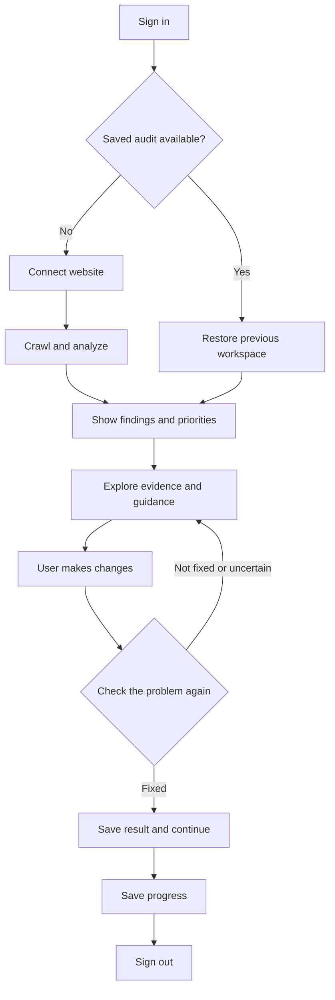

# Product research and experience design

## Understanding the problem

Search engine optimization (SEO) helps people discover websites through search engines. Technical SEO deals with whether search engines can access, understand and index pages. Fixing technical problems can help, but does not guarantee higher rankings.

While exploring SEO tools, I became interested in what happens after an audit. A website owner may receive hundreds of findings and still not know what to do first. Semrush, Ahrefs and Screaming Frog already offer useful auditing features. My aim is not to copy all of them, but to make the process of understanding and fixing problems easier.

| Who I am designing for | What they need |
|---|---|
| Website owner | Understand problems without specialist terminology |
| Freelancer | Explain affected pages and track fixes |
| Small agency | Organize website work and retain its history |

These are intended users, not confirmed customers.

## Research basis and product positioning

The starting point was an examination of existing SEO audit tools and the interpretation burden that can follow an audit. The comparison below describes the design focus, not a claim that competitors lack these capabilities.

| Existing audit workflow | COPLIT design focus |
|---|---|
| Discover and report technical issues | Organize related observations into understandable problems |
| Provide severity and recommendations | Connect priority and guidance to the affected website evidence |
| Re-audit or track issues | Make supported verification part of the guided resolution workflow |

Original research notes and customer interviews are not included in this portfolio; the user needs are product assumptions rather than validated market demand.

## What I decided to build

| Decision | Why | What to watch for |
|---|---|---|
| Group similar findings | Avoid repeating the same explanation for many pages | Keep every affected page visible; do not assume a shared cause |
| Prioritize problems | Help users decide where to begin | Severity is not a ranking prediction |
| Explain in simple English | Make technical findings understandable | AI must use collected evidence |
| Check fixes separately from AI | Advice alone cannot prove a fix | Each supported issue needs a suitable check |
| Save history | Users should not start over each time | Protect account ownership and restore saved state |
| Let users make changes | Keep control with the website owner | Do not modify websites automatically |

## From login to logout

This is the planned full experience. Saved-workspace restoration and the complete authenticated workflow still need end-to-end testing.

## An example

Imagine a bakery website has a link from /services to /old-pricing that returns HTTP 404 (page not found). COPLIT should show the source page, broken destination and observed response, explain why visitors cannot reach the page, and suggest updating the link. A recheck should inspect the relevant link and destination rather than simply accepting the user's confirmation. This is an illustrative scenario, not a recorded audit or a claim that this verifier is complete.

## How I would measure usefulness

I would measure how quickly users understand their first problem, how many supported problems they can fix and verify, whether explanations match website evidence, and whether users can resume previous work. These are proposed measures; no customer results have been collected.

[How the software works](ARCHITECTURE.md) · [What I have tested](VALIDATION-AND-LIMITATIONS.md)

---
[Portfolio home](README.md) · [Product](PRODUCT-CASE-STUDY.md) · [Architecture](ARCHITECTURE.md) · [AI](AI-INTELLIGENCE.md) · [Engineering](ENGINEERING-CASE-STUDIES.md) · [Validation](VALIDATION-AND-LIMITATIONS.md) · [LinkedIn](https://www.linkedin.com/in/aravindmugappagari)
