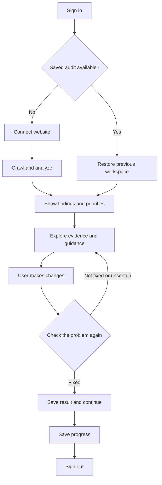

# Product research and experience design

## Understanding the problem

Search engine optimization (SEO) helps people discover websites through search engines. Technical SEO deals with whether search engines can access, understand and index pages. Fixing technical problems can help, but does not guarantee higher rankings.

While exploring SEO tools, I became interested in what happens after an audit. A website owner may receive hundreds of findings and still not know what to do first. Semrush, Ahrefs and Screaming Frog already offer useful auditing features. My aim is not to copy all of them, but to make the process of understanding and fixing problems easier.

| Who I am designing for | What they need |
|---|---|
| Website owner | Understand problems without specialist terminology |
| Freelancer | Explain affected pages and track fixes |
| Small agency | Organize website work and retain its history |

These are intended users, not confirmed customers.

## Research basis and product positioning

The starting point was an examination of existing SEO audit tools and the interpretation burden that can follow an audit. The comparison below describes the design focus, not a claim that competitors lack these capabilities.

| Existing audit workflow | COPLIT design focus |
|---|---|
| Discover and report technical issues | Organize related observations into understandable problems |
| Provide severity and recommendations | Connect priority and guidance to the affected website evidence |
| Re-audit or track issues | Make supported verification part of the guided resolution workflow |

Original research notes and customer interviews are not included in this portfolio; the user needs are product assumptions rather than validated market demand.

## What I decided to build

| Decision | Why | What to watch for |
|---|---|---|
| Group similar findings | Avoid repeating the same explanation for many pages | Keep every affected page visible; do not assume a shared cause |
| Prioritize problems | Help users decide where to begin | Severity is not a ranking prediction |
| Explain in simple English | Make technical findings understandable | AI must use collected evidence |
| Check fixes separately from AI | Advice alone cannot prove a fix | Each supported issue needs a suitable check |
| Save history | Users should not start over each time | Protect account ownership and restore saved state |
| Let users make changes | Keep control with the website owner | Do not modify websites automatically |

## Business value and product direction

For website owners, the intended benefit is less interpretation work. Freelancers need clear explanations they can share with clients, while agencies need a consistent record of corrections across engagements. These are intended benefits, not measured savings.

The strategic choice is depth of resolution over feature breadth. Reliable inspection comes first because guidance depends on trustworthy observations. Grouping and prioritization make those observations manageable, while issue-specific verification and history support continued work. This creates trade-offs in crawl coverage, verification coverage and state management.

## How findings become decisions

An observation is a fact collected from a page; a finding is a technical issue inferred from one or more observations using a supported check. Grouping reduces repeated explanations without discarding affected URLs. Priority determines the suggested order of work, not a guaranteed ranking improvement. Guidance explains a proposed correction; verification checks whether the relevant condition has changed.

## From login to logout

This diagram defines the full user journey. Authentication and workspace restoration are design requirements; their integrated acceptance is not established by the [recorded validation results](VALIDATION-AND-LIMITATIONS.md).

## Example: a missing page heading

A website owner needs to know which pages lack a main heading, why the heading matters and how to correct it. The guided workflow connects affected pages to the finding, explains the correction and checks the heading again after the user changes the website. Missing H1 is a documented supported verification example; this scenario is illustrative.

## Measuring product usefulness

| Proposed measure | Definition | Decision it informs |
|---|---|---|
| Time to first understood issue | Time from audit results to user understanding of a finding | Simplify explanations or navigation |
| Verified resolution rate | Verified fixes divided by supported findings attempted | Improve guidance or verification coverage |
| Evidence alignment | Share of evaluated factual explanations supported by observations | Improve retrieval and response quality |
| Workspace continuity | Successful resumption of prior work in evaluated sessions | Improve persistence and restoration |

These are evaluation definitions, not collected customer metrics.

---
**Next:** [System architecture](ARCHITECTURE.md) · [Portfolio home](README.md) · [Professional profile](https://github.com/aravind9154)
