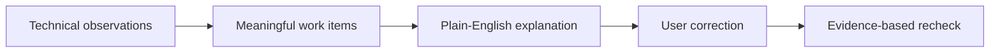
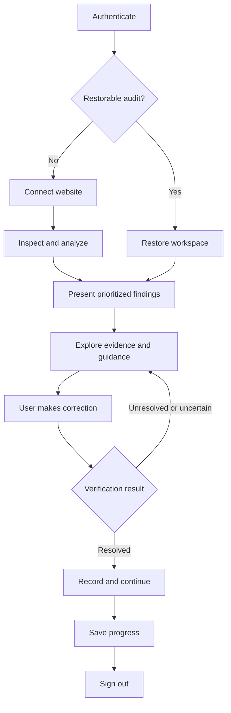

# Product discovery and design

## Starting with the user

Technical SEO helps search engines discover, interpret and access website content. A technical audit can reveal obstacles, but identifying an issue does not guarantee that a user understands its impact or knows how to resolve it.

COPLIT began with a question: **Can a website owner move from a technical finding to a verified correction without having to interpret every technical report alone?**

| Intended user | Job to be done |
|---|---|
| Website owner | Understand problems in plain English and decide where to begin |
| Freelancer | Identify affected pages, explain evidence and track corrections |
| Small agency | Organize corrective work and preserve its history |

These are intended user segments, not validated customer personas or adoption figures.

## Positioning

Semrush, Ahrefs and Screaming Frog are established tools with substantial audit capabilities. COPLIT does not attempt to reproduce their entire feature sets. Its product hypothesis is that a guided evidence-to-resolution workflow can reduce the interpretation burden for non-specialists.

## Product decisions

| Requirement | Chosen approach | Trade-off |
|---|---|---|
| Avoid overwhelming users | Group related findings, retain affected-page evidence | Grouping must not hide distinct causes |
| Help users start | Prioritize supported findings | Severity is not a guaranteed ranking impact |
| Make findings understandable | Contextual natural-language explanation | Model output needs grounding |
| Establish whether work succeeded | Separate deterministic verification | Requires a supported check for each issue type |
| Maintain continuity | Persist audit and verification history | Requires reliable ownership and restoration |
| Preserve user control | User changes their own website | No autonomous modification |

## Experience from sign-in to return

This is the intended journey; restoration and integrated runtime acceptance are not claimed complete.

## Example: turning an observation into work

Illustrative example, not a recorded customer audit:

| Stage | Example |
|---|---|
| Observation | A link on /services points to /old-pricing and returns HTTP 404 |
| Explanation | Visitors following the link cannot reach the intended page |
| Evidence | Source page, target URL and observed response |
| Guidance | Update the link to the correct existing destination |
| Verification | Re-observe the relevant link and destination; distinguish failure to fetch from resolution |

## Success criteria

Proposed evaluation measures: time to first meaningful action, proportion of supported work items verified, evidence completeness, explanation accuracy and successful restoration. No measured customer outcomes are claimed.

## My contribution

I defined requirements, evaluated product alternatives, designed workflows, coordinated AI-assisted development and investigated whether system behavior matched the intended experience. The project is independently developed.

[Architecture](ARCHITECTURE.md) · [Engineering investigations](ENGINEERING-CASE-STUDIES.md) · [Validation](VALIDATION-AND-LIMITATIONS.md)
