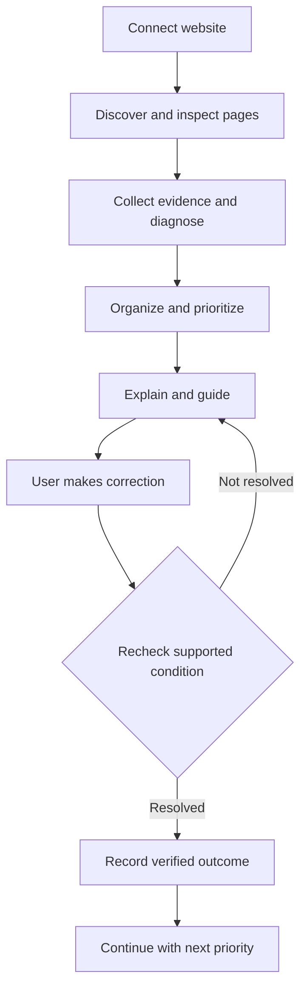
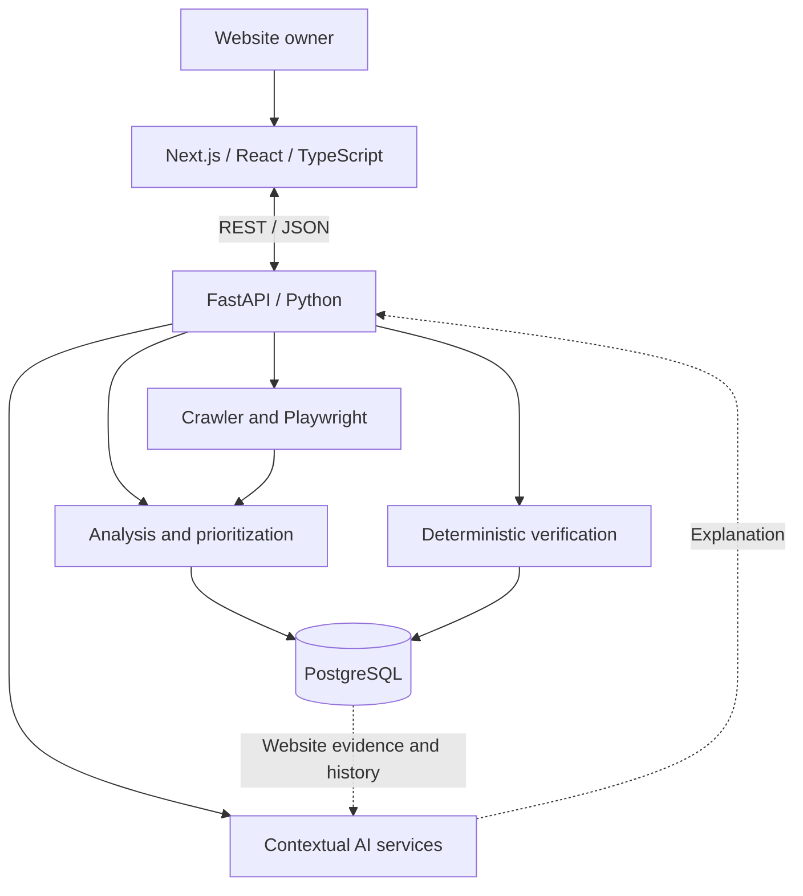

# COPLIT
### From technical SEO findings to verified corrective work

**Independent product and engineering project · Aravind Mugappagari**

COPLIT is an AI-powered technical SEO intelligence platform in active development. Its purpose is to help website owners understand what is wrong with their website, decide what to address first, and verify whether their corrections worked.

> Development-stage product. Private application source; public engineering documentation. No production-readiness or customer-adoption claims.

## The problem

SEO audits can reveal hundreds of observations. For a user without specialist knowledge, identifying a problem is only the beginning.

| User question | COPLIT's intended response |
|---|---|
| What is wrong? | Inspect the website and identify supported findings |
| Why does it matter? | Explain findings using page-level evidence |
| Where should I start? | Organize and prioritize related corrective work |
| What should I change? | Provide contextual guidance |
| Did it work? | Recheck supported conditions and preserve the outcome |

Established SEO platforms provide powerful auditing and research capabilities. COPLIT focuses on the narrower experience of moving from diagnosis to understandable, verified corrective work.

## The product journey

*Conceptual workflow; implementation and validation coverage vary by capability.*

## Explore the evidence

| Document | What it demonstrates |
|---|---|
| [Product case study](PRODUCT-CASE-STUDY.md) | Problem discovery, user experience, requirements and decisions |
| [System architecture](ARCHITECTURE.md) | Component responsibilities, technology choices and communication |
| [Engineering investigations](ENGINEERING-CASE-STUDIES.md) | Technical problems, reliability improvements and verification |
| [Validation and limitations](VALIDATION-AND-LIMITATIONS.md) | Recorded results, evidence boundaries and remaining work |

## System at a glance

The diagram represents logical responsibilities rather than a verified deployment topology. Gemini integration, retrieval and streaming require further integrated validation.

## Recorded engineering results

| Evidence | Recorded outcome | Scope |
|---|---|---|
| P11 syntax checks | 6/6 passed | Offline patch acceptance |
| P11 mocked behavior | 31/31 passed | Offline patch acceptance |
| P11 source contracts | 9/9 passed | Offline patch acceptance |
| Supported issue verification | Two findings verified after corrections | Prior local audit workflow |

These results are historical development records, not production benchmarks or proof of universal issue coverage.

## My contribution

I defined the product requirements and guided workflow, evaluated technology choices, coordinated AI-assisted implementation, investigated integration failures and reviewed validation results. My focus is understanding system behavior and establishing whether changes meet their intended requirements.

## Development boundaries

The private application remains under development. Wider verification coverage, integrated AI behavior, runtime reliability, security acceptance and production deployment are not claimed as completed. No credentials, private implementation code or customer data are included in this portfolio.
