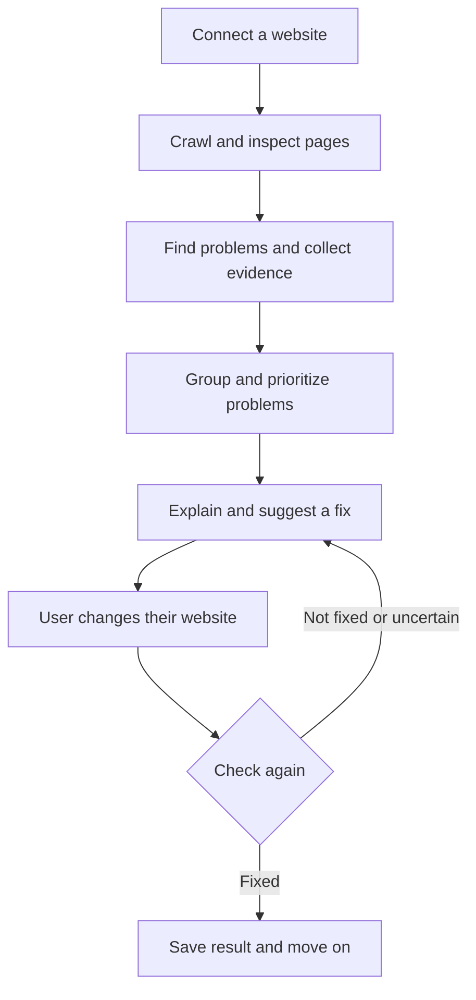
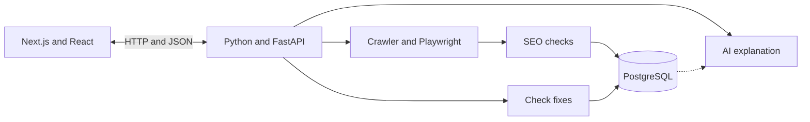

# COPLIT

**Helping website owners understand and fix technical SEO problems.**

I'm building COPLIT because finding a website problem and knowing how to fix it are two different things. Tools such as Semrush, Ahrefs and Screaming Frog provide detailed audits, but someone unfamiliar with SEO may still need help interpreting the results.

I want COPLIT to answer five questions: What is wrong? Why does it matter? Where should I start? How can I fix it? Did my change work?

## How it is designed to work

For example, if several pages have no main heading, the user should see one understandable problem with a list of affected pages, rather than having to interpret each report entry separately. The user makes the changes; COPLIT checks supported problems again.

## Explore the project

| Read about | What is inside |
|---|---|
| [Why I started COPLIT](PRODUCT-CASE-STUDY.md) | SEO, user needs, product choices and the journey from login to logout |
| [How the software works](ARCHITECTURE.md) | Frontend, backend, APIs, crawling, database, security and technology choices |
| [How the AI works](AI-INTELLIGENCE.md) | Gemini, LLMs, RAG, embeddings and website-specific answers |
| [Problems I worked on](ENGINEERING-CASE-STUDIES.md) | Timeouts, streaming, troubleshooting and checking fixes |
| [What I have tested](VALIDATION-AND-LIMITATIONS.md) | Recorded results and what still needs testing |

## The main parts

This shows the intended connections, not a deployed system. AI and retrieval still need complete integration testing.

## Progress so far

A recorded local audit verified two supported findings after corrections and moved to the next finding. A later reliability patch set passed 6 syntax checks, 31 mocked behavior checks and 9 source-contract checks. These are development results, not production performance measurements.

I work on the requirements, architecture, AI-assisted development, debugging and testing. The application source is private; this repository explains the work publicly. COPLIT is still under development.

Questions or feedback are welcome through [LinkedIn](https://www.linkedin.com/in/aravindmugappagari).
