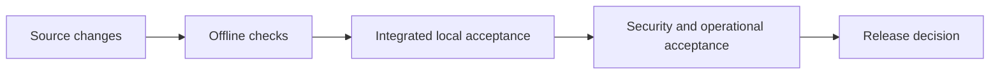

# Engineering validation and acceptance

## Recorded evidence

| Check | Outcome | Evidence scope |
|---|---|---|
| Reliability patch syntax | 6/6 passed | Recorded offline checks of the reliability changes |
| Reliability patch mocked behavior | 31/31 passed | Recorded offline patch acceptance |
| Reliability patch source contracts | 9/9 passed | Recorded offline patch acceptance |
| Conversational understanding | 17/17 passed | Recorded checks of conversational understanding |
| Local audit #58 | Two findings verified fixed; next finding progressed | Recorded local audit |

These are summarized development records. Original sanitized logs and independently reproducible demonstrations are not yet attached. No production benchmarks, customer outcomes or model accuracy claims are made.

## Integrated acceptance criteria — not yet established

| Capability | What needs checking |
|---|---|
| Authenticated workspace | End-to-end session and account ownership checks |
| Website inspection | Safe resource limits and supported observation coverage |
| API reliability | Live deadline and HTTP 504 behavior |
| SSE | Completion, disconnect and error cleanup |
| Persistence | Recovery, transaction consistency and workspace restoration |
| AI and retrieval | Website scope, evidence grounding and provider failure handling |
| Verification | Supported issue coverage and uncertain outcomes |
| Production readiness | Dependency reproducibility, migrations, security and operational readiness |

## Quality decisions

| Outcome | Decision |
|---|---|
| Syntax check passes | Proceed to behavioral checks; do not infer runtime correctness |
| Mocked behavior passes | Retain the result within its controlled test scope |
| Verification evidence is insufficient | Keep the finding unresolved or uncertain |
| Integrated behavior is unverified | Do not represent it as accepted |

The acceptance approach distinguishes a plausible implementation from a demonstrated outcome.

## Release acceptance sequence

Passing a syntax check means the code can be parsed. Mocked checks test behavior using controlled substitutes for dependencies. Source-contract checks examine expected code relationships. None of these alone proves that the whole application works with real services. The private implementation and credentials are not published.

[Engineering investigations](ENGINEERING-CASE-STUDIES.md) · [Architecture](ARCHITECTURE.md)

---
[Portfolio home](README.md) · [Product](PRODUCT-CASE-STUDY.md) · [Architecture](ARCHITECTURE.md) · [AI](AI-INTELLIGENCE.md) · [Engineering](ENGINEERING-CASE-STUDIES.md) · [Validation](VALIDATION-AND-LIMITATIONS.md) · [LinkedIn](https://www.linkedin.com/in/aravindmugappagari)
