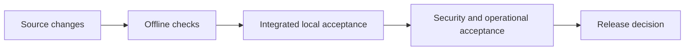

# Validation and development status

## Recorded evidence

| Check | Outcome | Evidence scope |
|---|---|---|
| P11 syntax | 6/6 passed | Historical offline patch acceptance |
| P11 mocked behavior | 31/31 passed | Historical offline patch acceptance |
| P11 source contracts | 9/9 passed | Historical offline patch acceptance |
| Conversational understanding | 17/17 passed | Historical local component checks |
| Local audit #58 | Two findings verified fixed; next finding progressed | Historical local workflow |

These are summarized development records. Original sanitized logs and independently reproducible demonstrations are not yet attached. No production benchmarks, customer outcomes or model accuracy claims are made.

## What remains to be established

| Capability | Acceptance needed |
|---|---|
| Authenticated workspace | End-to-end session and account ownership checks |
| Website inspection | Safe resource limits and supported observation coverage |
| API reliability | Live deadline and HTTP 504 behavior |
| SSE | Completion, disconnect and error cleanup |
| Persistence | Recovery, transaction consistency and workspace restoration |
| AI and retrieval | Website scope, evidence grounding and provider failure handling |
| Verification | Supported issue coverage and uncertain outcomes |
| Production readiness | Dependency reproducibility, migrations, security and operational readiness |

## Release decision

Recorded checks establish progress at specific stages, not completion of every gate. The project remains in active development. The private implementation and credentials are not published.

[Engineering investigations](ENGINEERING-CASE-STUDIES.md) · [Architecture](ARCHITECTURE.md)
