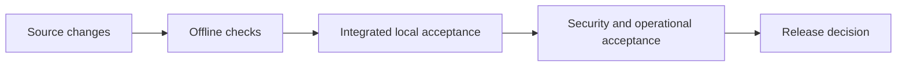

# Engineering validation and acceptance

## What was tested and what the results establish

| Area tested | What the check evaluated | Recorded result and meaning |
|---|---|---|
| Python syntax | Whether the six changed Python files could be parsed | All six passed; establishes syntactic validity, not runtime correctness |
| Streaming lifecycle | Handling the lifecycle of incremental responses under controlled conditions | Six mocked checks passed; live disconnect behavior remains unverified |
| Deadline handoff | Passing the request time budget between service layers | Five mocked checks passed; supports deadline propagation in the tested scenarios |
| Database connection timeout | Bounding connection waiting using the supplied time budget | Eight mocked checks passed; no live database connection was exercised |
| Transaction timeout and rollback | Transaction waiting limits and rollback behavior | Twelve mocked checks passed; live transaction recovery remains unverified |
| Persistence contracts | Acceptance and forwarding of timeout arguments through persistence functions | Four source checks passed; confirms expected code relationships |
| API timeout contracts | Deadline handler uniqueness, HTTP 504 mapping and forwarding timeout arguments | Five source checks passed; does not establish a live HTTP 504 response |
| Conversational understanding | Component-level interpretation of user questions | Seventeen recorded checks passed; individual cases are not available in the retrieved record, and integrated model grounding is not established |
| Local API readiness | GET requests to /openapi.json, /docs and /health | All returned HTTP 200; confirms local API responsiveness, not complete application functionality |
| Frontend type checking | TypeScript compiler validation | Exit code 0; does not establish browser behavior |
| Website correction | Recheck missing H1 and missing meta description after user corrections | Both findings were recorded as fixed in local audit #58, followed by progression to the next finding |

The reliability checks used offline mocks and source inspection without live database, network or Gemini calls. These are recorded development summaries, not original logs. Individual case names for all mocked and conversational checks are unavailable in the retrieved records. No production benchmarks or customer outcomes are claimed.

## Integrated acceptance criteria — not yet established

| Capability | What needs checking |
|---|---|
| Authenticated workspace | End-to-end session and account ownership checks |
| Website inspection | Safe resource limits and supported observation coverage |
| API reliability | Live deadline and HTTP 504 behavior |
| SSE | Completion, disconnect and error cleanup |
| Persistence | Recovery, transaction consistency and workspace restoration |
| AI and retrieval | Website scope, evidence grounding and provider failure handling |
| Verification | Supported issue coverage and uncertain outcomes |
| Production readiness | Dependency reproducibility, migrations, security and operational readiness |

## Quality decisions

| Outcome | Decision |
|---|---|
| Syntax check passes | Proceed to behavioral checks; do not infer runtime correctness |
| Mocked behavior passes | Retain the result within its controlled test scope |
| Verification evidence is insufficient | Keep the finding unresolved or uncertain |
| Integrated behavior is unverified | Do not represent it as accepted |

The acceptance approach distinguishes a plausible implementation from a demonstrated outcome.

## Release acceptance sequence

Passing a syntax check means the code can be parsed. Mocked checks test behavior using controlled substitutes for dependencies. Source-contract checks examine expected code relationships. None of these alone proves that the whole application works with real services. The private implementation and credentials are not published.

[Engineering investigations](ENGINEERING-CASE-STUDIES.md) · [Architecture](ARCHITECTURE.md)

---
[Portfolio home](README.md) · [Product](PRODUCT-CASE-STUDY.md) · [Architecture](ARCHITECTURE.md) · [AI](AI-INTELLIGENCE.md) · [Engineering](ENGINEERING-CASE-STUDIES.md) · [Validation](VALIDATION-AND-LIMITATIONS.md) · [LinkedIn](https://www.linkedin.com/in/aravindmugappagari)
