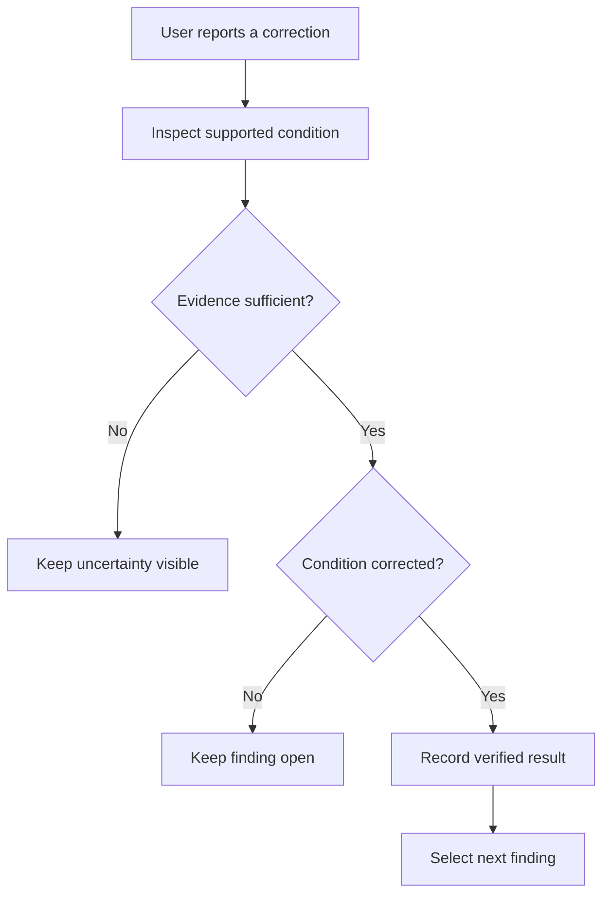

# Associate Product Manager: COPLIT evidence

Problem framing, requirements, priorities and product judgment.

I work as a Product Builder across software systems and applied AI. This page explains how my personal product work relates to this role; it does not claim that I have held this job.

## The decision a reviewer can assess

**Problem:** The central question was what a website owner should do after receiving an audit. Existing tools already offer diagnosis and recommendations; COPLIT’s design focus was a continuous guided resolution workflow.

**My contribution:** A recommendation is useful, but it does not establish that a user’s correction worked. I made independent verification a separate product responsibility. My documented contribution spans requirements, product and system decisions, AI-assisted implementation coordination, investigation and review of validation results. Code generation was AI-assisted; no claim of unaided authorship is made.

**Recorded result:** Local audit #58 recorded two supported corrections verified as fixed and progression to the next finding. This demonstrates a bounded workflow outcome, not adoption or customer value.

## Requirement to evidence

| Requirement | COPLIT work | Evidence | What a reviewer can ask |
|---|---|---|---|
| Product definition and strategy | Connect the problem to a bounded decision | Product and engineering records | Why this decision, and what alternative did you reject? |
| Validation | Check the relevant condition or contract | Local workflow or simulated checks, as labelled | What did the check establish and what did it leave open? |
| Communication | Explain the system in terms of the user’s next decision | Portfolio narrative and linked evidence | Can you explain it without relying on the diagram? |

## Worked product case: from “I fixed it” to verified progress

The intended user is a website owner who can make a correction but needs to know whether it worked. This is a product assumption informed by audit-workflow research, not a customer interview finding.

| Option considered | Benefit | Risk | Product choice |
|---|---|---|---|
| Accept the user’s “fixed” action | Immediate progress | A reported action can be mistaken for a result | Keep the request separate from verified state |
| Let an LLM decide whether the fix worked | Conversational explanation | Generated agreement does not inspect the page | Use the model for explanation, not verification authority |
| Reinspect the supported page condition | Observable evidence | Fetch failure and unsupported conditions need explicit handling | Use dedicated checks and preserve uncertainty |

The comparison explains the product rationale; it does not claim an experiment comparing all three implementations.

| Acceptance requirement | What the record supports |
|---|---|
| Success requires fresh relevant evidence | The local verification case rechecked corrected H1 and meta-description conditions |
| Resolution changes the workflow | Audit #58 recorded both fixes and next-finding progression |
| A failed or inconclusive check should not resolve a finding | Required behavior; a complete live failure-path acceptance record is not supplied |
| The user should see a clear outcome | Audit #53 exposed a visible-status communication gap despite changed evidence |

## Prioritization and sequencing

The documented strategy favors a small supported resolution loop before broad SEO coverage: trustworthy inspection, page evidence, understandable guidance and independent verification. Authentication, restoration and AI grounding require their own acceptance. This is a product sequence and trade-off, not a dated delivery roadmap or a claim of finished features.

## Proposed product measures

| Measure | Definition | Decision supported | Status |
|---|---|---|---|
| Verified resolution rate | Verified fixes / supported attempts, with inconclusive outcomes reported separately | Improve guidance or verification coverage | Proposed; no customer data |
| Time to first understood issue | Elapsed time until a test participant accurately explains a finding | Improve explanations and navigation | Proposed; no measured baseline |
| Successful resumption | Sessions that restore the expected task and evidence / evaluated resumptions | Improve continuity | Proposed; no measured rate |

Two verified findings in one local audit are an engineering result; they are not a customer resolution-rate estimate. I would use user feedback and measured usability to test the product assumptions before claiming market validation.

## Remaining selection questions

Customer discovery, usability feedback, collaboration with a product team and measured user outcomes are not established by this case.

## Read the underlying work

[Product study](../PRODUCT-CASE-STUDY.md) · [Architecture](../ARCHITECTURE.md) · [Engineering cases](../ENGINEERING-CASE-STUDIES.md) · [Validation](../VALIDATION-AND-LIMITATIONS.md) · [Evidence index](../EVIDENCE-INDEX.md)

The examples above are historical local records, documented decisions or explicitly labelled illustrative scenarios. They are not production customer incidents.
