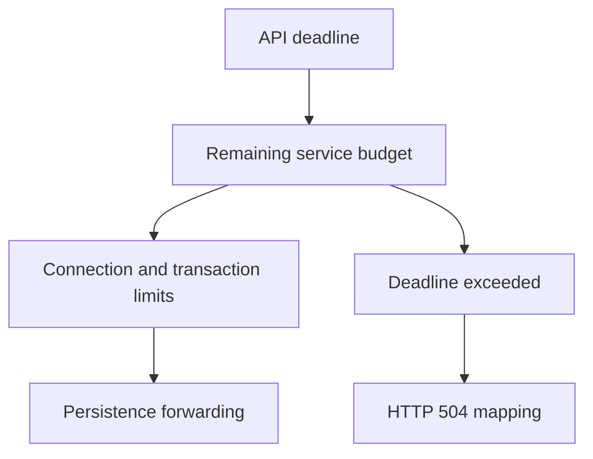

# Junior Software / Graduate Engineer: COPLIT evidence

Executable code, boundary reasoning, tests and technical explanation.

I work as a Product Builder across software systems and applied AI. This page explains how my personal product work relates to this role; it does not claim that I have held this job.

## The decision a reviewer can assess

**Problem:** An API deadline is ineffective if downstream database or persistence work ignores the remaining budget.

**My contribution:** Trace the time budget through service calls, connection waiting, transactions and persistence; map an exceeded deadline at the API boundary. My documented contribution spans requirements, product and system decisions, AI-assisted implementation coordination, investigation and review of validation results. Code generation was AI-assisted; no claim of unaided authorship is made.

**Recorded result:** P11 records 6 syntax, 31 mocked behavior and 9 source-contract checks for six reliability patches. Separately, this package tests the existing public TypeScript VM without changing its source.

## Requirement to evidence

| Requirement | COPLIT work | Evidence | What a reviewer can ask |
|---|---|---|---|
| Implementation and reliability | Connect the problem to a bounded decision | Product and engineering records | Why this decision, and what alternative did you reject? |
| Validation | Check the relevant condition or contract | Local workflow or simulated checks, as labelled | What did the check establish and what did it leave open? |
| Communication | Explain the system in terms of the user’s next decision | Portfolio narrative and linked evidence | Can you explain it without relying on the diagram? |

## Reliability boundary

The diagram summarizes P11’s recorded patch responsibilities. The 31 mocked checks, 9 structural checks and 6 syntax checks answer different questions; they must not be added into a production reliability percentage.

## Executable public sample

The separate [Tiny Stack Virtual Machine](https://github.com/aravind9154/tiny-stack-virtual-machine) contains public TypeScript implementation. The review package adds a documented Node.js command, fixtures and CLI-level checks without modifying main.ts. The new test results are dated and labelled as generated during this review, not as Aravind’s original assessment result. It is separate from COPLIT and does not validate the FastAPI application.

## Remaining selection questions

The newer FastAPI source is not present in the connected COPLIT repository inspected here. Its full runtime, Linux depth, coding assessment readiness and team code review remain separate questions.

## Read the underlying work

[Product study](../PRODUCT-CASE-STUDY.md) · [Architecture](../ARCHITECTURE.md) · [Engineering cases](../ENGINEERING-CASE-STUDIES.md) · [Validation](../VALIDATION-AND-LIMITATIONS.md) · [Evidence index](../EVIDENCE-INDEX.md)

The examples above are historical local records, documented decisions or explicitly labelled illustrative scenarios. They are not production customer incidents.
