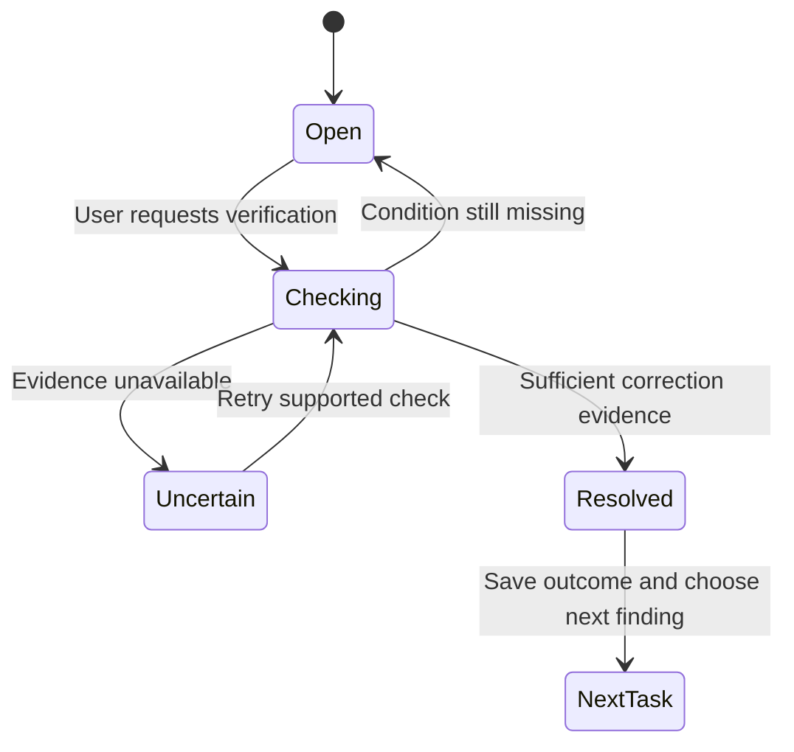

# Product Operations Associate: COPLIT evidence

Workflow clarity, state continuity, operational definitions and handoffs.

I work as a Product Builder across software systems and applied AI. This page explains how my personal product work relates to this role; it does not claim that I have held this job.

## The decision a reviewer can assess

**Problem:** Users need to know the current finding, the result of a supported check and which task comes next.

**My contribution:** Treat a verification outcome and next-task selection as linked operational steps, with a clear unresolved or uncertain path. My documented contribution spans requirements, product and system decisions, AI-assisted implementation coordination, investigation and review of validation results. Code generation was AI-assisted; no claim of unaided authorship is made.

**Recorded result:** A 23 September history record reports 43/43 verification checks and a targeted H1 open-to-resolved transition, one history write and next-task progression. No LLM call was made.

## Requirement to evidence

| Requirement | COPLIT work | Evidence | What a reviewer can ask |
|---|---|---|---|
| Workflow and evidence operations | Connect the problem to a bounded decision | Product and engineering records | Why this decision, and what alternative did you reject? |
| Validation | Check the relevant condition or contract | Local workflow or simulated checks, as labelled | What did the check establish and what did it leave open? |
| Communication | Explain the system in terms of the user’s next decision | Portfolio narrative and linked evidence | Can you explain it without relying on the diagram? |

## State and handoff model

The state diagram is a readable operating model derived from the documented requirements; it is not a literal code export. The historical Stage 4 record supports the successful targeted transition, persistence/history and next-task path. The other branches need their own execution evidence.

| Operational rule | Why it matters |
|---|---|
| Preserve audit and finding identity | Prevent unrelated evidence being used for a task |
| Separate open, resolved and uncertain outcomes | Avoid a misleading completion count |
| Select the next task from authoritative state | Keep the interface and saved work aligned |
| Distinguish targeted verification from a whole-site crawl | Make the operation’s scope understandable |

## Remaining selection questions

Commercial operations ownership, team handoffs, customer adoption and automation-platform expertise are not established.

## Read the underlying work

[Product study](../PRODUCT-CASE-STUDY.md) · [Architecture](../ARCHITECTURE.md) · [Engineering cases](../ENGINEERING-CASE-STUDIES.md) · [Validation](../VALIDATION-AND-LIMITATIONS.md) · [Evidence index](../EVIDENCE-INDEX.md)

The examples above are historical local records, documented decisions or explicitly labelled illustrative scenarios. They are not production customer incidents.
